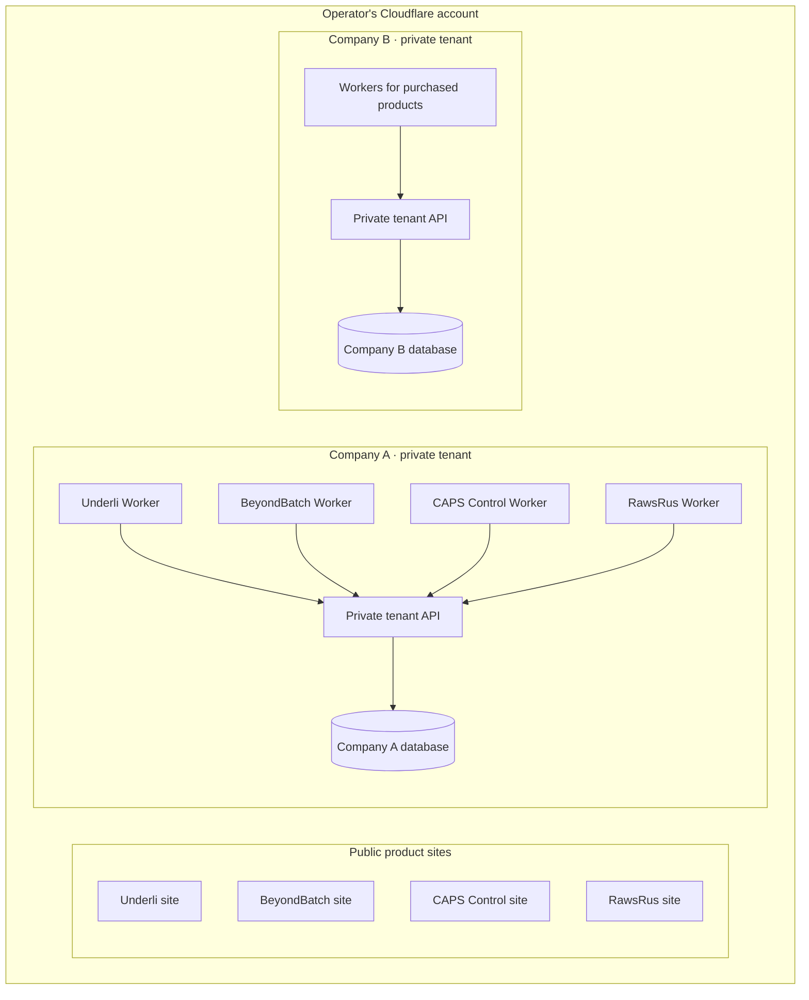

# How the four products share customer data

**Architecture decision · November 17, 2026.** Run four independently deployable private applications on Cloudflare. For each subscribing company (a *tenant*), give its enabled applications one private data API and one shared business database. The platform operator manages the Cloudflare account. Each product also has its own public site. This diagram shows the agreed design for implementation.

The four public sites have no bindings to tenant APIs, databases or private files. Within a private tenant, each product Worker calls that company's API through a Cloudflare Service Binding. The API owns database access and checks the calling app, user or service identity, tenant membership, requested operation and record permissions. Sharing a record across products preserves those permissions. Keep attachments and signed documents in authorized tenant storage and share their IDs through the API.

## Who maintains each record?

| Product | Records it maintains through the tenant API | How another product uses them |
| --- | --- | --- |
| RawsRus | Materials, suppliers, RFQs and price history | CAPS Control reads the price and quantity break for a formula ingredient. |
| CAPS Control | Formulas, revisions, costings and issued quotes | BeyondBatch links a customer request to the exact quote version. |
| BeyondBatch | Requests, tickets, owners, deadlines and operational dependencies | Underli shows leadership which customer is waiting for a reply. |
| Underli | PM portfolio assignments and reporting views over source invoices | BeyondBatch can look up the customer's primary PM when routing a new request. |

Use stable customer, material, product, project and quote IDs across the four apps. Preserve source-system IDs for imports and reconciliation. Domain owners define the allowed edits. For example, a later supplier price updates the next costing. An issued quote retains the price used when it was sent.

## How additional customers fit

Provision another tenant API, database, private storage and tenant-scoped credentials. Point only that company's purchased product Workers at those resources. A company can start with CAPS Control alone and add RawsRus later against the same tenant data. Product releases remain independent. Keep the API compatible with deployed app versions as the schema evolves. Each tenant chooses its identity and network policy.

## What this means for BeyondBatch

Customer ticketing belongs in [the BeyondBatch module](../modules/customer-ticketing/README.md). The review build uses fictional data. A future tenant integration should link a request to the customer and quote IDs, record the accountable owner and preserve the reply deadline. The email thread and attachments retain their own access rules. See [the PM and Supply Chain workspaces](../tasks/plan.md).
